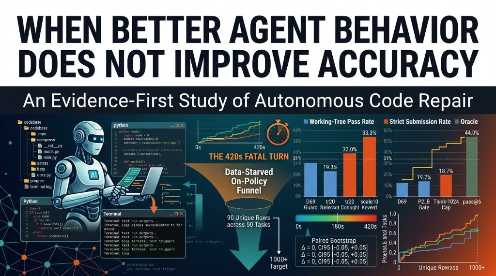
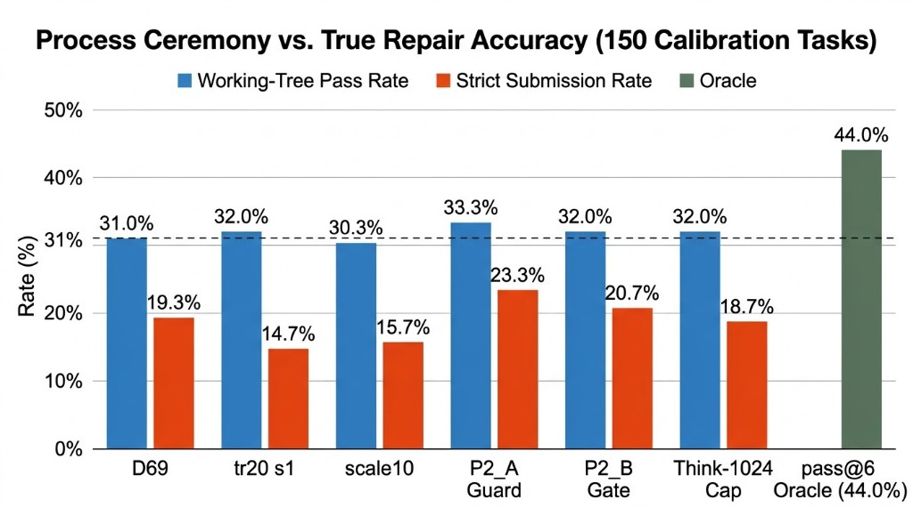
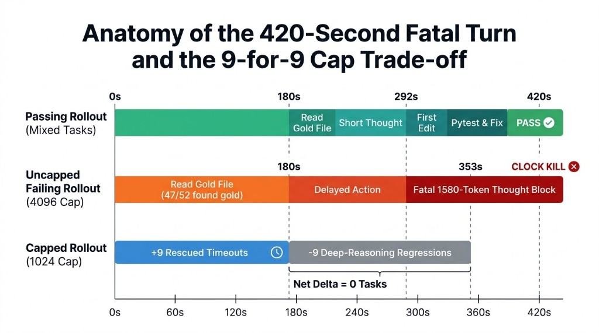
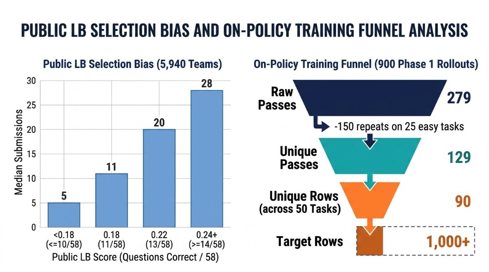

# When Better Agent Behavior Does Not Improve Accuracy

## An evidence-first retrospective on building and evaluating a code-repair agent for the Gemma 4 Developer Agent Competition


**Author:** Moran Zavdi  
**Evidence cutoff:** 2026-11-17  
**Competition:** [Google — The Gemma 4 Developer Agent Competition](https://www.kaggle.com/competitions/gemma-4-developer-agent)  
**Scope:** 31B main track, E4B small-model track, the final 1,350-episode calibration campaign, and relevant Kaggle submissions  
**Supporting files:** [GitHub repository](https://github.com/Aeterna-Data-AI-ML-Research/Kaggle-Gemma-4-Developer-Agent-Competition) (`evidence/`, `benchmark/`, `scripts/reproduce_all_tables.py`, `notebooks/`)  
**Kaggle dataset + notebooks:** [gemma4-agent-behavior-vs-accuracy](https://www.kaggle.com/datasets/moranzavdi/gemma4-agent-behavior-vs-accuracy) · [reproduce](https://www.kaggle.com/code/moranzavdi/reproduce-gemma4-agent-behavior-study) · [explore](https://www.kaggle.com/code/moranzavdi/explore-gemma4-agent-calibration)

---

## Abstract

We built and evaluated an autonomous software-repair agent for Kaggle's Gemma 4 Developer Agent Competition. The agent had to inspect unfamiliar Python repositories, localize defects, edit code through host-provided tools, and produce patches that passed hidden tests. The fixed 31B model was capable enough to solve a meaningful fraction of tasks, but the project repeatedly encountered a measurement problem: small local panels and single leaderboard submissions could not distinguish real improvements from sampling noise.

To address this, we built a 300-task evaluation pool, froze a 150-task calibration split and a 150-task sealed test split, implemented a virtual clock matching the host budget, and ran 1,350 controlled episodes across known agent configurations. The final campaign included 900 Phase 1 calibration episodes, 300 submit-guard episodes, and 150 thinking-budget episodes. It produced four central results.

First, three configurations with materially different Kaggle scores were statistically indistinguishable offline: working-tree pass rates ranged from 30.3% to 32.0%, and every paired confidence interval included zero. Second, an oracle over six rollouts raised the solve rate from roughly 31% to 44%, showing substantial stochastic headroom but no deployable selection mechanism. Third, most clock-killed episodes had already found the relevant file; failures were dominated by late editing, long reasoning bursts, incomplete fixes, and weak patch construction rather than simple localization. Fourth, reducing the thinking budget from 4,096 to 1,024 tokens successfully changed behavior—long thoughts nearly disappeared and more episodes submitted patches—but did not improve accuracy: both capped and uncapped runs solved exactly 48 of 150 tasks.

The public leaderboard told the same story. Our stable unadapted 31B agent scored 0.18, while every trained or heavily modified configuration scored 0.17 or below. The final decision was therefore to stop GPU spending and retain the stable 0.18 submission. The broader lesson is that agentic software engineering requires evaluation at the task level, paired controls, and explicit separation of behavioral improvements from capability improvements.



---

## Reproducing the numbers

```bash
git clone https://github.com/Aeterna-Data-AI-ML-Research/Kaggle-Gemma-4-Developer-Agent-Competition.git
cd Kaggle-Gemma-4-Developer-Agent-Competition
pip install -r requirements.txt
python scripts/reproduce_all_tables.py
```

All tables in Sections 4–8 are pinned against `evidence/*.jsonl` (see `evidence/SCHEMA.md`).

---

## 1. Competition setting

The competition required a declarative Google ADK submission rather than an arbitrary executable agent. The submitted bundle specified prompts, tools, sampling settings, budgets, and optionally an adapter. Host-side Python from the submission did not run. The agent operated under several hard constraints:

- a fixed Gemma 4 model variant;
- a 32k context window;
- a global 12-hour generation budget;
- a per-episode tool-call and time budget;
- hidden Python repair tasks;
- one slow competition submission per day (probably the most difficult constraint);
- up to two final selections;
- final ranking on a private task set.

The main model was `gemma-4-31b-it-qat-w4a16-ct`. The small-model bonus used `gemma-4-e4b-it-qat-w4a16-ct`.

The public leaderboard contained 5,940 teams at the final snapshot used in this report. Its score lattice is consistent with 58 public tasks and truncation to two decimals:

| Public score | Implied solved tasks |
|---:|---:|
| 0.06 | 4 / 58 |
| 0.10 | 6 / 58 |
| 0.13 | 8 / 58 |
| 0.17 | 10 / 58 |
| 0.18 | 11 / 58 |
| 0.20 | 12 / 58 |
| 0.22 | 13 / 58 |
| 0.24 | 14 / 58 |
| 0.29 | 17 / 58 |

This matters because a one-task swing changes the displayed score by about 0.017. A change from 0.18 to 0.20 can therefore represent a single additional solved task rather than a broad capability gain.

At the snapshot:

- the leading public score was 0.29, or 17 of 58 tasks;
- 15 teams had at least 0.24;
- 124 had at least 0.22;
- 653 had at least 0.20;
- our team ranked 752nd at 0.18;
- 1,133 teams were tied at 0.18.

These are public-board observations, not estimates of private-board performance.

---

## 2. Why the original evaluation loop was unreliable

Early development used local panels containing 9–13 tasks. Those panels were useful for wiring checks but had very high statistical uncertainty. On a 13-task panel, one task changes the reported rate by 7.7 percentage points. A configuration scoring 4/13 could look dramatically stronger than one scoring 2/13 even when the difference was mostly task selection or sampling noise.

The Kaggle leaderboard was not a clean replacement:

1. only one submission was available per day;
2. the public board contained 58 tasks;
3. model sampling was stochastic;
4. the public and private task sets differed;
5. many submissions changed several variables simultaneously.

The resulting feedback loop encouraged overinterpretation. Local panel winners frequently regressed on Kaggle, and public leaderboard reproductions did not reproduce across teams. Several public configurations reported near 0.24 elsewhere but scored 0.12–0.18 when reproduced in our account.

The project therefore moved from leaderboard-driven iteration to an evidence-first evaluation protocol.

---

## 3. Evaluation design

### Terminology and configuration glossary

Throughout this study, we refer to experimental arms and harness concepts using the internal identifiers recorded in our benchmark manifests and reproducible evidence packs:

| Identifier | Kind | Definition |
| --- | --- | --- |
| **D69** (Base-31B Reference) | Model arm | Unadapted `gemma-4-31b-it-qat-w4a16-ct` baseline with a 6-tool declarative contract (`read_file`, `edit_file`, `write_file`, `run_shell`, `grep_search`, `submit_patch`), `thinking_budget = 4096`, no LoRA adapter (14.0 tok/s). Public LB **0.18** (11/58). |
| **ForgeSWE** (SurgicalTune) | Training method | Targeted PEFT recipe for 4-bit QAT models: freeze attention projections (`q/k/v/o_proj`) to preserve long-context localization; train rank-8 LoRA on MLP projections (`gate/up/down_proj`) over verified on-policy repair trajectories. |
| **tr20** (Adapter-Scale-2.0) | Model arm | ForgeSWE rank-8 LoRA (`r = 8`) served with `lora_alpha = 16` (effective scale 2.0), temperature 0.2, and 4 domain skill declarations. ~7.1% Punica throughput tax (13.006 tok/s). Public LB **0.17** (10/58). |
| **scale10** (Adapter-Scale-1.0) | Model arm | Same LoRA tensors as tr20, halved adapter scale (`lora_alpha = 8`, effective scale 1.0) and greedy decoding (`temperature = 0.0`). Public LB **0.13** (8/58). |
| **P2_A** (Clock-Guard) | Harness arm | tr20 plus harness-injected virtual-clock warnings at 330 s and 375 s prompting finalize + `submit_patch` before the 420 s deadline. |
| **P2_B** (Test-Gate) | Harness arm | P2_A plus a pre-submission gate that intercepts `submit_patch` once if pytest has not run since the last file modification. |
| **Think-1024** (`a1_think1024`) | Serving arm | tr20 (seed 1, temperature 0.2) with vLLM per-turn `thinking_budget` reduced from 4,096 to 1,024 tokens. |
| **Working-tree pass (WT)** | Primary metric | Final working-tree state passes hidden tests at episode end, whether or not `submit_patch` was called. Matches host grading when an explicit submit is absent. |
| **Strict pass** | Process metric | Patch passes **and** the agent called `submit_patch` before budget exhaustion. |
| **Virtual clock** | Evaluation clock | Deterministic host-budget simulator: decoding latency (`tokens / tok_per_sec`) plus tool wall time against a 420 s per-episode cap. |

### 3.1 Task pool and split discipline

We assembled a task pool from public benchmark tasks and mined merged pull requests from eleven Python repositories:

`fastapi`, `starlette`, `pydantic`, `rich`, `requests`, `httpx`, `click`, `flask`, `pytest`, `attrs`, and `urllib3`.

Each mined task underwent two-sided soundness checks:

1. the repository had to fail under the empty patch;
2. it had to pass under the gold patch.

The final experimental structure was:

| Split | Tasks | Purpose |
|---|---:|---|
| `calib` | 150 | model and scaffold comparisons |
| `test` | 150 | sealed go/no-go evaluation |
| `train` | 426 | trajectory generation and training |
| `holdout` | 4 | reserve eval-only extras |

The calibration and test sets were stratified into:

- `competition_public`: known public competition tasks;
- `competition_new`: newly mined tasks from competition repositories;
- `other`: tasks from the remaining repositories.

The 150-task calibration split contained 23 `competition_public`, 35 `competition_new`, and 92 `other` tasks.

### 3.2 Scoring

We reported two verdicts:

1. **Working-tree pass (WT):** the final working-tree patch passed the grader, whether or not the agent explicitly called `submit_patch`.
2. **Strict pass:** the patch passed and the agent called `submit_patch`.

WT was the primary metric because the host grader uses the working-tree diff when an explicit submission is absent. Strict pass remained useful as an operational metric.

### 3.3 Virtual clock

The host budget was modeled with a virtual clock:

- 14.0 tokens/s for the unadapted 31B model;
- 13.006 tokens/s for the rank-8 adapter;
- 420 seconds per episode;
- 28 tool calls;
- 80 turns;
- tool wall time added to generation time.

This made comparisons independent of GPU batch speed while preserving the host's effective generation budget.

### 3.4 Controlled variables

Phase 1 compared three known configurations:

| Arm | Description | Prior Kaggle score |
|---|---|---:|
| D69 | stable 31B reference | 0.18 |
| tr20 | ForgeSWE SurgicalTune lineage | 0.17 |
| scale10 | lower served adapter scale | 0.13 |

Each arm ran two seeds on all 150 calibration tasks:

`3 arms × 2 seeds × 150 tasks = 900 episodes`.

The protocol used paired bootstrap intervals over tasks and changed one experimental variable at a time.

---

## 4. Phase 1: known leaderboard differences disappeared offline

Phase 1 completed all 900 planned episodes.

| Configuration | Episodes | WT pass | Strict pass | Mean virtual time |
|---|---:|---:|---:|---:|
| D69 | 300 | 93/300 = 31.0% | 58/300 = 19.3% | 399.5 s |
| tr20, seed 0 | 150 | 47/150 = 31.3% | 27/150 = 18.0% | 402.0 s |
| tr20, seed 1 | 150 | 48/150 = 32.0% | 22/150 = 14.7% | 405.3 s |
| scale10 | 300 | 91/300 = 30.3% | 47/300 = 15.7% | 412.0 s |

Every paired WT comparison included zero:

- tr20 seed 1 minus D69: +1.0 percentage point, 95% CI [−4.7, +6.7];
- tr20 pooled minus D69: +0.7 points, 95% CI [−3.3, +4.7];
- scale10 minus D69: −0.7 points, 95% CI [−4.7, +3.3].

This was the first major result: the local instrument did not reproduce the leaderboard ordering. D69 scored 0.18 on Kaggle, tr20 scored 0.17, and scale10 scored 0.13, yet all three were effectively tied on the 150-task calibration set.

There are two possible interpretations:

1. the calibration distribution differed from Kaggle's hidden distribution;
2. the public leaderboard differences were partly sampling variance.

The data do not identify which explanation dominates. What they do show is that a small offline advantage could not justify a new submission.

---

## 5. Sampling headroom was real but not deployable

Across the six Phase 1 rollouts per task, an oracle that selected any passing rollout solved:

- 66/150 tasks by WT = 44.0%;
- 49/150 tasks by strict scoring = 32.7%.

The typical single run solved 45–48 tasks, or about 31%. Thus pass@6 exposed roughly 13 percentage points of stochastic headroom.

The 150 tasks divided into:

- 25 tasks solved in all six rollouts;
- 41 mixed tasks solved in some but not all rollouts;
- 84 tasks never solved.

The mixed tasks were the most informative. Comparing passing and failing rollouts on the same task:

- passing runs edited about 59 virtual seconds earlier;
- passing runs used about 91 fewer completion tokens per turn;
- their largest turn was about 620 tokens shorter;
- they completed about three more turns;
- 37/129 passing rollouts had a turn over 1,500 tokens, versus 71/117 failing rollouts.

The pattern was not "successful runs think more." Successful runs distributed work across more, shorter steps and edited earlier.

However, the competition format did not permit an unconstrained best-of-N policy. Any deployable multi-attempt scheme had to remain within the shared 12-hour wall and select a patch without access to the hidden oracle. The measured pass@6 result was therefore a capability ceiling, not a shippable gain.

---

## 6. Failure anatomy: localization was not the dominant bottleneck

The tr20 seed-1 run contained 74 failing clock-timeout episodes:

- 52 `timeout_empty_diff`;
- 22 failing `timeout_unsubmitted_with_diff`.

The 52 empty-diff timeouts looked like localization failures, but tool traces showed otherwise:

- 47/52 had already called `read_file` on a gold file;
- 48/52 had opened a gold file through either `read_file` or shell;
- 33/52 opened every gold file;
- 46/52 never attempted an edit;
- six attempted edits, and five of those attempts all failed.

The median fatal turn began with 67 seconds left, generated about 1,580 tokens, spent roughly 74% of those tokens in reasoning, and ended in a tool call that could not execute before the virtual clock expired.

For the 22 timeout failures that did produce a diff:

- the first edit occurred at median turn 16;
- the first edit occurred around virtual second 351;
- 19 edited a gold file;
- 16 failed tests with return code 1;
- six encountered return code 2.

This distinction mattered. The model often knew where to work, but it delayed action until there was too little budget left to edit, test, diagnose, and repair.

### 6.1 Tool wall time was not the cause

Median tool wall time for the 74 timeout failures was only 0.33 seconds. Generation dominated the virtual clock. Raising tool speed would not have solved the problem.

### 6.2 Scratch files were not the cause

Across all 1,200 Phase 1 and Phase 2 episodes:

- 823 failed WT;
- 19 failed episodes created an agent-specific untracked file;
- 15 of those files contributed no source hunk after stripping;
- zero failures became a correct gold-equivalent patch after removing scratch files.

The `git add -N .` behavior was worth auditing, but it explained none of the observed failures.

---

## 7. Phase 2: submission guards improved process compliance, not accuracy

Phase 2 ran two variants of the tr20 winner:

- **P2_A:** clock-aware submit notices at 330 and 375 seconds;
- **P2_B:** P2_A plus a pre-submit test gate.

Each variant ran once on all 150 calibration tasks, adding 300 episodes.

| Arm | WT pass | Strict pass |
|---|---:|---:|
| P1 tr20 seed 1 | 48/150 = 32.0% | 22/150 = 14.7% |
| P2_A | 50/150 = 33.3% | 35/150 = 23.3% |
| P2_B | 48/150 = 32.0% | 31/150 = 20.7% |

P2_A improved strict pass over the paired Phase 1 baseline by 8.7 points, with a 95% interval excluding zero. Yet WT remained statistically flat.

The guard caused agents to submit patches that were already present in the working tree. It improved protocol compliance but did not improve the patches.

This is an important evaluation lesson: a proxy metric can move substantially while the actual objective remains unchanged.



*Figure 1: Working-tree pass rate (blue, graded by the host via `git diff`) versus strict submission rate (orange, explicit `submit_patch` calls) across all six evaluated configurations on the 150-task calibration split. While process-level interventions (`P2_A` clock notices and the `1,024`-token thinking cap) shift strict submission compliance by up to +8.6 percentage points, true repair accuracy remains locked inside the 30.3%–33.3% band. Only the non-deployable `pass@6` oracle (44.0%) separates from the baseline.*

---

## 8. Thinking-budget intervention: a successful behavioral manipulation with zero accuracy gain

The timeout analysis suggested a direct intervention. The serving configuration allowed up to 4,096 reasoning tokens in one turn. In the 52 empty-diff timeout episodes, a simulation predicted that clipping the fatal turn to:

- 2,048 tokens would let 9 turns finish;
- 1,536 tokens would let 18 turns finish;
- 1,024 tokens would let 32 turns finish;
- 768 tokens would let 38 turns finish.

This was only an upper bound. Finishing a tool call is not equivalent to producing a correct patch, and shorter thoughts could damage successful runs. In the Phase 1 bank, 62/279 passing episodes contained a thought longer than 1,024 tokens.

We therefore ran a full paired experiment rather than testing only the failures:

- same tr20 adapter;
- same temperature 0.2;
- same seed 1;
- same 150 calibration tasks;
- only `thinking_budget` changed, from 4,096 to 1,024.

### 8.1 Final result

| Metric | 1,024-token cap | 4,096-token baseline |
|---|---:|---:|
| WT pass | 48/150 = 32.0% | 48/150 = 32.0% |
| Strict pass | 28/150 = 18.7% | 22/150 = 14.7% |
| Pairwise flips | 9 wins | 9 wins |
| Paired WT delta | 0.0 points | — |
| 95% CI | [−6.0, +5.3] points | — |
| Time-budget endings | 77 | 85 |
| Submitted endings | 45 | 34 |
| Episodes with estimated thought >1,024 | 3 | 63 |

The intervention worked exactly as a behavioral control:

- long thoughts nearly disappeared;
- time-budget endings fell;
- explicit submissions increased;
- strict pass improved.



*Figure 2: Timeline anatomy of the 420-second virtual clock across the 150 calibration tasks. Passing rollouts on mixed tasks edit ~59s earlier using shorter reasoning turns (Track 1). In 47 of 52 uncapped empty-diff timeouts, the agent already read the gold file but delayed editing until ~353s, launching a ~1,580-token thought block that expired the clock before `edit_file` could execute (Track 2). Capping thoughts at 1,024 tokens (Track 3) rescues +9 timeout tasks but induces −9 regressions on tasks requiring deep continuous reasoning, yielding a net accuracy delta of 0 tasks (48/150 vs. 48/150).*

But WT accuracy did not move by one task.

The result rules out a simple story in which long reasoning bursts were the principal obstacle. They were a visible symptom of failure, but suppressing them did not create missing repair capability.

### 8.2 Stratum results

| Stratum | 1,024 cap | Baseline tr20 | D69 mean |
|---|---:|---:|---:|
| `competition_new` | 14/35 | 11/35 | 10.0/35 |
| `competition_public` | 7/23 | 7/23 | 8.0/23 |
| `other` | 27/92 | 30/92 | 28.5/92 |

The capped arm gained three tasks in `competition_new` and lost three in `other`. This is redistribution, not a general improvement.

---

## 9. Training data: much smaller than the raw pass count suggested

The 900 Phase 1 episodes produced 279 passing trajectories. The 300 Phase 2 episodes added 98 passes. A raw count of 377 looks substantial, but it overstates useful training diversity:

- 150 Phase 1 passes came from 25 tasks solved in all six rollouts;
- the 279 Phase 1 passes covered only 66 tasks;
- after excluding eval-only competition-mined tasks, 216 passes remained across 50 tasks;
- capping repeated trajectories at two per task left 90 rows across 50 tasks;
- 62 Phase 2 passes contained harness notices not present in production.

The final SFT builder used:

- 102 training rows on 40 tasks;
- 10 task-level development rows;
- eight `competition_new` rows for evaluation only;
- maximum sequence length 24,576;
- attention-locked MLP continuation from the tr20 ForgeSWE lineage.

This was far below the plan's target of at least 1,000 verified rows. The experiment could test training plumbing, but it could not support a strong claim about scalable self-distillation.



*Figure 3: (Left) Median submission count per team across score brackets on the 58-task public leaderboard (n = 5,940 teams), illustrating best-of-N selection pressure under stochastic sampling (σ ≈ 1.4 tasks). (Right) The on-policy trajectory funnel from 900 Phase 1 calibration episodes: 279 raw passing trajectories collapse to 90 usable SFT rows across 50 unique tasks after removing 150 repeated solves on 25 always-solved tasks and holding out evaluation strata—an order of magnitude below the 1,000+ unique rows needed for reliable 31B self-distillation.*

---

## 10. Training attempt and infrastructure outcome

The training arm ran on an H100 NVL:

- 25 planned optimizer steps;
- gradient accumulation 4;
- learning rate 1e-4;
- checkpoints at steps 12 and 25;
- 38.7 million trainable adapter parameters;
- attention LoRA tensors frozen;
- MLP LoRA tensors trainable.

Step-0 validation loss was:

- 0.0985 token-weighted on the development rows;
- 0.0740 on the eval-only `competition_new` rows.

The first four training losses were:

`0.057 → 0.099 → 0.057 → 0.172`.

The volume-less training pod disappeared after step 4 and returned 404 from the provider. Only the untouched step-0 adapter and logs were synchronized. No step-12 or step-25 checkpoint existed, so no evaluation or weight-delta analysis was possible.

This run provides no evidence for or against the training method. It does provide an operational lesson: expensive training on an ephemeral volume needs checkpoint synchronization at a cadence shorter than the provider-failure interval. Waiting until step 12 created an avoidable recovery gap.

Per the operator lock, no replacement pod was created.

---

## 11. Leaderboard evidence

Our strongest main-track submissions were stable unadapted or minimally modified configurations:

| Submission class | Public score | Implied tasks |
|---|---:|---:|
| Stable unadapted / D69-class | 0.18 | 11 / 58 |
| ForgeSWE tr20-class | 0.17 | 10 / 58 |
| Lower-scale / spectral / graft packs | ≤ 0.13 | ≤ 8 / 58 |

The project repeatedly found that local panel gains did not transfer:

- d100 spectral scored 4/9 locally but only 0.13 on Kaggle;
- lower-scale and spectral variants remained near their parents in weight space yet lost several hidden tasks;
- prompt grafts reduced the leaderboard score by about 0.05;
- exact reproductions of public high-scoring packs did not reproduce their reported score in our account.

The evidence does not imply that training cannot improve a 31B coding agent. It implies that our training scale, task diversity, and validation protocol did not demonstrate such an improvement.

---

## 12. Small-model track

The E4B track behaved differently:

- E4B decoded at roughly 43–51 tokens/s locally, versus about 13–14 tokens/s for the adapted 31B;
- failures in the 13-task E4B autopsy were predominantly syntax errors, wrong conditions, and missed companion edits rather than clock exhaustion;
- successive E4B submissions moved from 0.03 to 0.05 to 0.06, corresponding to two, three, and four public tasks.

The best E4B submission therefore showed a real two-task improvement over the earliest E4B run. However:

- the last observed small-model leader was 0.10, or six public tasks;
- at least 12 teams were tied at that score in the last available small-board snapshot;
- the bonus was a single prize decided on private performance;
- the available 31B distillation set covered only about 40–50 useful tasks after filtering.

One additional E4B distillation run was economically defensible, but its expected value was low. The operator chose to stop rather than spend further GPU budget.

---

## 13. Operational controls and cost

The final campaign used (that is only the final campaign, in addition to several hundred dollars of earlier work):

- five A40 pods for evaluation;
- one H100 NVL for the interrupted training attempt;
- automatic result synchronization;
- pod-side deadline watchdogs;
- Mac-side spend enforcement;
- automatic termination after shard completion;
- immutable submission artifacts;
- no credentials copied to pods;
- no modification of the frozen agent scaffold.

The final thinking-cap / training attempt run cost **$6.56** against a reduced **$14** hard cap:

| Component | Spend (USD) |
|---|---:|
| Five A40 evaluation pods | 5.06 |
| H100 training (interrupted) | 1.50 |
| **Total** | **6.56** |

The 900 Phase 1 and 300 Phase 2 episodes had previously cost $32.73. Thus the final 1,350-episode measurement campaign cost approximately $39.29, excluding earlier project work.

An audit found that every evaluation pod had accidentally been marked `hold=true`, which would have prevented Mac-side stage-completion termination. The flag was corrected while runs were active. All five evaluation pods subsequently terminated automatically with reason `stage_done`.

---

## 14. What worked

### 14.1 Measurement infrastructure

The project replaced anecdotal panel results with:

- complete paired task coverage;
- bootstrap intervals;
- explicit strata;
- two scoring definitions;
- deterministic virtual-time accounting;
- full trajectory preservation;
- failure taxonomies;
- sealed test and holdout sets.

This infrastructure produced stronger conclusions than another leaderboard submission would have.

### 14.2 Behavior-level interventions

Clock notices and a lower thinking budget reliably changed:

- submission frequency;
- reasoning length;
- timeout frequency;
- strict compliance.

This demonstrates that agent behavior can be controlled even when underlying task accuracy remains fixed.

### 14.3 Cost and safety controls

The final fleet respected the reduced spend cap, synchronized all completed evaluation outputs, terminated at zero burn, kept the test split sealed, and made no new submission.

---

## 15. What did not work

### 15.1 Small panels as model selectors

Panels of 9–13 tasks were useful smoke tests but unreliable optimization targets. Several panel winners regressed by three or more public tasks.

### 15.2 Treating process metrics as capability metrics

Strict submission rate improved sharply, but WT pass stayed flat. More compliant behavior did not imply better patches.

### 15.3 Assuming clock symptoms were causal

Long thoughts were associated with failure. Removing them did not improve accuracy. Correlation correctly identified a failure pattern but not a sufficient intervention.

### 15.4 Weak training volume

Approximately 100 diverse rows are enough to test a trainer, not enough to establish a new coding capability in a 31B model. Repeated passes on the same easy tasks inflated the apparent bank size.

### 15.5 Leaderboard hill-climbing

The public board had coarse one-task steps, stochastic sampling, and distribution shift. Submitting local winners without a strong paired gate repeatedly spent daily slots without increasing the floor.

---

## 16. Decision

The campaign stopped for three evidence-based reasons:

1. **No demonstrated main-track lever.** D69, tr20, scale10, Phase 2 guards, and the thinking cap were statistically tied by WT.
2. **Capability ceiling on the available pool.** Eighty-four of 150 calibration tasks were never solved in the six-rollout Phase 1 oracle, and the thinking-cap run added only one newly solved task.
3. **Prize distance.** The stable main-track score represented 11 public tasks; the leader solved 17. Nothing measured suggested a credible six-task improvement.

The retained final candidates were:

- a stable 0.18 31B submission;
- the 0.06 E4B submission.

No sealed-test G3 evaluation was run, the 150-task test split remained sealed, and no new Kaggle submission was made after the stop decision.

---

## 17. General lessons for coding-agent research

### Lesson 1: Evaluate patches, not ceremony

Explicit submission, clean termination, and test invocation are useful operational metrics. The primary metric must still be whether the final repository state passes.

### Lesson 2: Pair by task

Independent aggregate pass rates waste information. Running configurations on identical tasks and bootstrapping task-level differences makes small experiments substantially more interpretable.

### Lesson 3: Separate localization, execution, and repair

"No final diff" does not mean "failed to find the file." Tool traces showed that many empty-patch failures had already localized correctly. The failure occurred between understanding and action.

### Lesson 4: Intervene on all tasks, not only failures

Testing a shorter thinking budget only on previous timeouts would have created selection bias and hidden regressions on successful tasks. The full 150-task paired run showed the net effect was zero.

### Lesson 5: Count unique tasks, not trajectories

Repeated solutions of easy tasks make a trajectory bank look large. Diversity at the task and failure-mode level is more important than raw row count.

### Lesson 6: A behavioral change is not a capability change

The thinking cap is a clean example: it altered reasoning length, endings, and submission behavior while leaving solved-task count unchanged.

### Lesson 7: Infrastructure failures are part of experimental design

Checkpoint cadence, immutable artifacts, spend caps, and automatic termination are not secondary operations work. They determine whether an experiment produces usable evidence.

### Lesson 8: Stopping is a scientific outcome

Once all measured interventions were flat and the remaining plan required an order-of-magnitude increase in data, stopping preserved budget and prevented further overfitting to a noisy public board.

---

## 18. Limitations

1. The calibration distribution did not reproduce the Kaggle ordering among D69, tr20, and scale10.
2. The sealed 150-task test split was never opened, by design.
3. The public leaderboard task count is inferred from the observed score lattice; it is not an official disclosed count.
4. The private evaluation distribution and task count were not observable.
5. Phase 2 clock notices were harness-only behavior and therefore not directly shippable.
6. The thinking-budget comparison used one temperature and one seed.
7. The ForgeSWE continuation training run did not reach a checkpoint beyond step 0.
8. The small-model leaderboard snapshot was older than the final main-board snapshot.
9. Local virtual time modeled host behavior but could not reproduce every host scheduling effect.

These limitations narrow the claims. The report establishes what the measured interventions did on the calibration instrument; it does not establish a universal ceiling for Gemma 4 coding agents.

---

## 19. Reproducibility map

**Public research repository:**
[Aeterna-Data-AI-ML-Research/Kaggle-Gemma-4-Developer-Agent-Competition](https://github.com/Aeterna-Data-AI-ML-Research/Kaggle-Gemma-4-Developer-Agent-Competition)

| Artifact | Path |
| --- | --- |
| Compact evidence (1,350 episodes) | `evidence/phase{1,2,3}_*.jsonl` |
| Evidence schema | `evidence/SCHEMA.md` |
| Task / split manifest (730 tasks) | `benchmark/tasks_manifest.jsonl` |
| Virtual-clock protocol | `benchmark/PROTOCOL.md` |
| One-command table reproduction | `scripts/reproduce_all_tables.py` |
| Figures 1–3 + hero art | `docs/figures/` |
| Stripped baseline config shape | `configs/baseline_d69/` |

| Experiment | Episodes |
|---|---:|
| Phase 1 calibration | 900 |
| Phase 2 guards | 300 |
| Phase 3 thinking cap | 150 |
| **Total** | **1,350** |

---

## 20. Suggested article framing

**Proposed title:** When Better Agent Behavior Does Not Improve Accuracy: An Evidence-First Study of Autonomous Code Repair

**One-sentence thesis:** In autonomous software repair, shorter reasoning, earlier submission, and fewer timeouts can make an agent look operationally better without increasing the number of tasks it solves.

**Recommended emphasis:**

1. the transition from noisy leaderboard iteration to paired task-level evaluation;
2. the difference between localization and execution failures;
3. the thinking-budget intervention as a clean negative result;
4. the need to count unique training tasks rather than trajectories;
5. the value of stopping rules in expensive agent research.

**Claims to avoid:**

- that 1,024 reasoning tokens are always optimal;
- that reasoning is harmful in general;
- that ForgeSWE or adapter training cannot work at larger scale;
- that the public and private leaderboards share the same task distribution;
- that the 58-task public count was officially disclosed;
- that the interrupted training run tested the training hypothesis.

---

## Conclusion

The project began with a leaderboard question: how could an 0.18 coding agent reach 0.29? It ended with a more useful scientific answer. The agent's visible inefficiencies—long thoughts, late edits, missing submission calls, and clock deaths—were real, measurable, and controllable. But fixing them did not create the missing capability required to solve more tasks.

The decisive experiment reduced the reasoning budget by 75%, cut long-thought episodes from 63 to three, reduced clock endings, and increased submissions. Accuracy remained exactly 48 of 150.

That negative result is the central contribution. It demonstrates why coding-agent evaluation must distinguish operational behavior from task success, why paired task-level experiments matter, and why a disciplined stop decision can be more informative than another uncalibrated leaderboard submission.

---

## Credits

**Author:** Moran Zavdi  
**Repository:** [Aeterna-Data-AI-ML-Research/Kaggle-Gemma-4-Developer-Agent-Competition](https://github.com/Aeterna-Data-AI-ML-Research/Kaggle-Gemma-4-Developer-Agent-Competition)  
**License:** Apache-2.0
