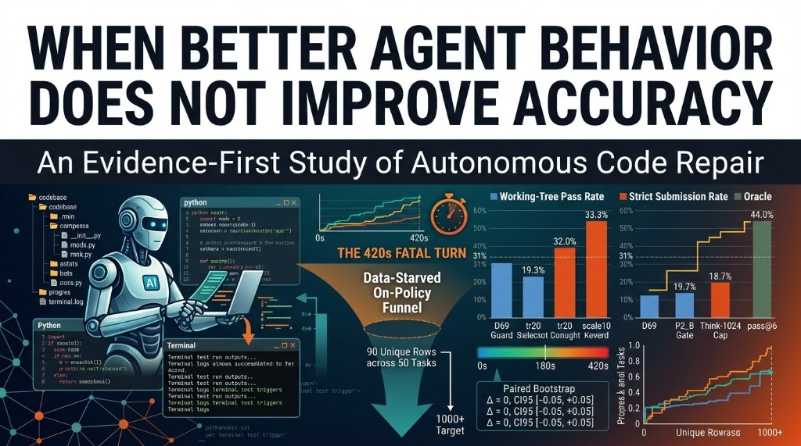
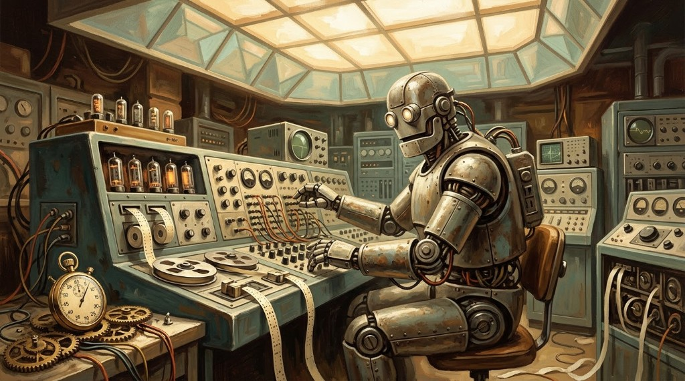
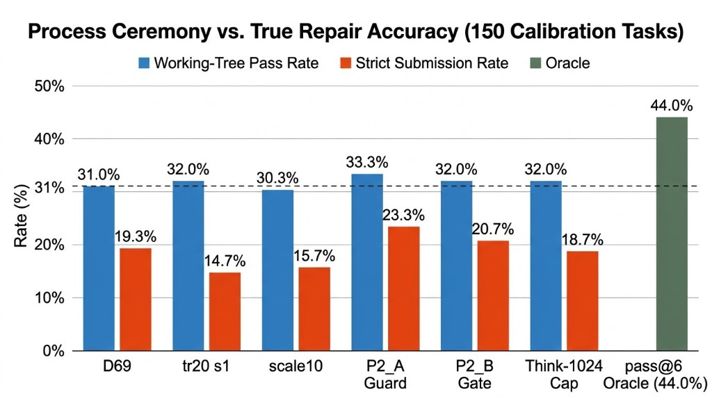
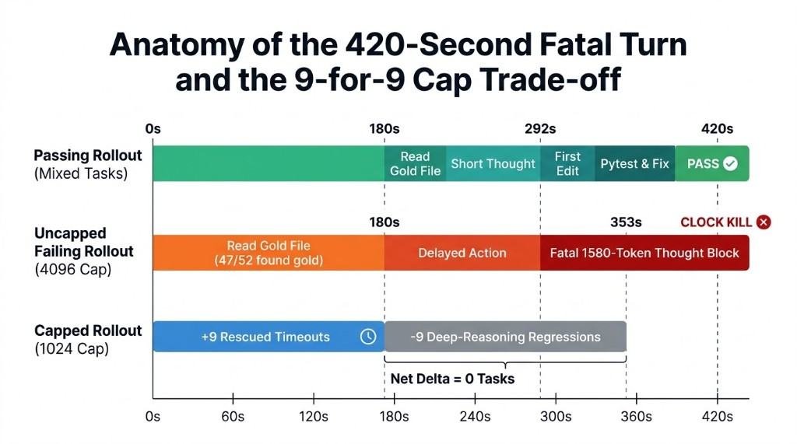
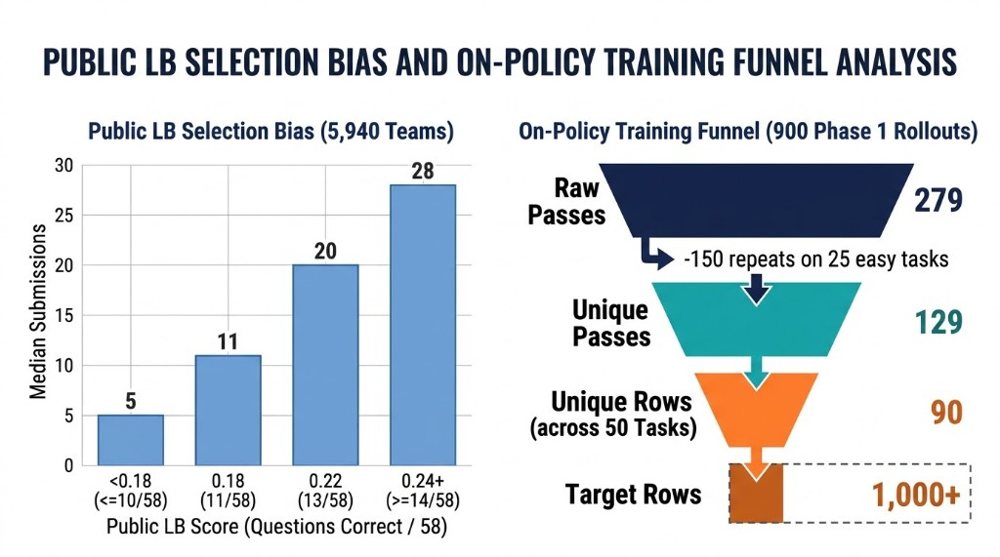

# When Better Agent Behavior Does Not Improve Accuracy

Evidence-first study of a Gemma 4 autonomous code-repair agent for the Kaggle
Gemma 4 Developer Agent Competition.

**Author:** Moran Zavdi  
**License:** Apache-2.0  
**Kaggle:** [Google — The Gemma 4 Developer Agent Competition](https://www.kaggle.com/competitions/gemma-4-developer-agent)  
**Article:** [`PAPER.md`](PAPER.md) · [GitHub Pages (one-page article)](https://aeterna-data-ai-ml-research.github.io/Kaggle-Gemma-4-Developer-Agent-Competition/)  
**Notebooks:** [`notebooks/`](notebooks/) · [Reproduce](https://www.kaggle.com/code/moranzavdi/reproduce-gemma4-agent-behavior-study) · [Explore](https://www.kaggle.com/code/moranzavdi/explore-gemma4-agent-calibration) · [Lessons](https://www.kaggle.com/code/moranzavdi/gemma4-agent-lessons-for-competitors)  
**Dataset:** [moranzavdi/gemma4-agent-behavior-vs-accuracy](https://www.kaggle.com/datasets/moranzavdi/gemma4-agent-behavior-vs-accuracy)  
**Medium:** https://medium.com/@when1go2market  
**Evidence cutoff:** 2026-11-17

<p align="center">
  
</p>

<p align="center">
  
</p>

## Thesis

In autonomous software repair, shorter reasoning, earlier submission, and fewer
timeouts can make an agent look operationally better **without** increasing the
number of tasks it solves.

## Key findings (150-task calibration)

1. **D69 / tr20 / scale10 were statistically tied offline** (WT ≈ 30.3–32.0%;
   every paired CI included zero) despite Kaggle scores 0.18 / 0.17 / 0.13.
2. **pass@6 oracle ≈ 44%** — stochastic headroom without a deployable selector.
3. **Localization was not the bottleneck** — most clock-killed empty-diff
   episodes had already opened a gold file; failures were late edits and long
   reasoning bursts.
4. **Think-1024 changed behavior, not accuracy** — long thoughts nearly vanished
   and submits rose, but WT stayed exactly **48/150 vs 48/150**.

## One-command reproduce

```bash
git clone https://github.com/Aeterna-Data-AI-ML-Research/Kaggle-Gemma-4-Developer-Agent-Competition.git
cd Kaggle-Gemma-4-Developer-Agent-Competition
pip install -r requirements.txt
python scripts/reproduce_all_tables.py
```

Pins every table in [`PAPER.md`](PAPER.md) Sections 4–8 against
`evidence/*.jsonl` (~1–2 s on a laptop CPU).

## Figures

| Fig | File | Placement in PAPER |
| ---: | --- | --- |
| 1 | [`fig1_wt_vs_strict.jpg`](docs/figures/fig1_wt_vs_strict.jpg) | End of §7 — WT vs strict + pass@6 |
| 2 | [`fig2_fatal_turn_timeline.jpg`](docs/figures/fig2_fatal_turn_timeline.jpg) | §8.1 — 420 s fatal turn & 9-for-9 trade-off |
| 3 | [`fig3_lb_and_funnel.jpg`](docs/figures/fig3_lb_and_funnel.jpg) | End of §9 — LB submission bias + SFT funnel |

<p align="center">
  
</p>

<p align="center">
  
</p>

<p align="center">
  
</p>

## Glossary (short)

| ID | Meaning |
| --- | --- |
| **D69** | Unadapted 31B baseline (public LB 0.18) |
| **tr20** | ForgeSWE LoRA scale 2.0 (public LB 0.17) |
| **scale10** | Same LoRA, scale 1.0 (public LB 0.13) |
| **P2_A / P2_B** | Clock-guard / clock-guard + pytest gate |
| **Think-1024** | `thinking_budget` 4096 → 1024 |
| **WT / Strict** | Working-tree pass vs explicit `submit_patch` pass |

Full definitions are in [`PAPER.md` §3](PAPER.md#terminology-and-configuration-glossary).

## Public Kaggle assets (start here)

Curated for other competitors and DS readers. Everything below is **public** and Apache-2.0 where we own the files.

### Agent-track (this study)

| Asset | Why it helps | Link |
| --- | --- | --- |
| **Dataset** — 1,350 compact episodes + scripts + lattice + configs | Reproduce every PAPER table; inspect WT vs process metrics | [gemma4-agent-behavior-vs-accuracy](https://www.kaggle.com/datasets/moranzavdi/gemma4-agent-behavior-vs-accuracy) |
| **Notebook** — pin tables | Fail-closed CI gate for §§4–8 | [reproduce-gemma4-agent-behavior-study](https://www.kaggle.com/code/moranzavdi/reproduce-gemma4-agent-behavior-study) |
| **Notebook** — explore calibration | Episode EDA (WT, submits, gold-file opens, Think-1024) | [explore-gemma4-agent-calibration](https://www.kaggle.com/code/moranzavdi/explore-gemma4-agent-calibration) |
| **Notebook** — competitor lessons | LB lattice, Think-1024 trap, timeout localization lesson | [gemma4-agent-lessons-for-competitors](https://www.kaggle.com/code/moranzavdi/gemma4-agent-lessons-for-competitors) |
| Cheatsheet in-repo | Same lessons offline | [`reports/LESSONS_FOR_COMPETITORS.md`](reports/LESSONS_FOR_COMPETITORS.md) · [`reports/lb_lattice.csv`](reports/lb_lattice.csv) |

### Paper-track (related)

| Asset | Why it helps | Link |
| --- | --- | --- |
| Soundness / Punica evidence dataset | Host vs local validation claims + toolkit | [gemma4-soundness-and-punica-bench](https://www.kaggle.com/datasets/moranzavdi/gemma4-soundness-and-punica-bench) |
| Reproduce notebook | Recomputes paper-track numbers end-to-end | [from-local-validation-to-live-evaluation](https://www.kaggle.com/code/moranzavdi/from-local-validation-to-live-evaluation) |

### Intentionally *not* uploaded

Private smoke/train kernels, adapter weights, submission zips, proprietary prompt grafts, sealed-test trajectories, and overnight ops dumps. Those do not help fair public measurement and would either leak competition IP or create misleading “copy this pack” shortcuts.

## Notebooks (in git)

| Notebook | What it does | Kaggle |
| --- | --- | --- |
| [`notebooks/01_reproduce_tables.ipynb`](notebooks/01_reproduce_tables.ipynb) | Pins PAPER.md §§4–8 against `evidence/*.jsonl` | [reproduce…](https://www.kaggle.com/code/moranzavdi/reproduce-gemma4-agent-behavior-study) |
| [`notebooks/02_explore_calibration.ipynb`](notebooks/02_explore_calibration.ipynb) | Episode EDA | [explore…](https://www.kaggle.com/code/moranzavdi/explore-gemma4-agent-calibration) |
| [`notebooks/03_lessons_for_competitors.ipynb`](notebooks/03_lessons_for_competitors.ipynb) | Competitor field guide over the public dataset | [lessons…](https://www.kaggle.com/code/moranzavdi/gemma4-agent-lessons-for-competitors) |

## Layout

```text
PAPER.md           Final retrospective article
notebooks/         Reproduce + explore notebooks (also on Kaggle)
benchmark/         tasks_manifest.jsonl + PROTOCOL.md
evidence/          phase1/2/3 compact JSONL + SCHEMA.md
configs/           stripped D69-shaped baseline (no proprietary prompts)
docs/figures/      hero art + Figures 1–3
research/         supporting MD archive (plans, overnight, phase reports)
scripts/           reproduce_all_tables.py, plot_figures.py, …
reports/           appendices
```

## Supporting research

The thin top-level tree is for fast reproduction. The longer research trail that
supported the evidence lives under [`research/`](research/) (plans, overnight
reports, phase analyses, audits, findings ledger).

## Included / excluded

| Included | Excluded |
| --- | --- |
| Compact episodes with turn-level summaries | Raw tool args, reasoning text, git diffs |
| 730-task split manifest | Adapter weights / submission zips |
| Virtual-clock protocol | Graded sealed-test trajectories |
| Stripped baseline config shape | Proprietary ops playbooks |

Base model weights and the competition host are out of band (see `NOTICE`).

## SEO / AEO / GEO

| File | Role |
| --- | --- |
| [`docs/robots.txt`](docs/robots.txt) | Crawler allow + AI bots + sitemap |
| [`docs/sitemap.xml`](docs/sitemap.xml) | Pages URL index |
| [`docs/llms.txt`](docs/llms.txt) / [`llms.txt`](llms.txt) | Answer-engine brief (AEO) |
| [`docs/llms-full.txt`](docs/llms-full.txt) | Expanded machine index (GEO) |
| [`docs/ai.txt`](docs/ai.txt) | Training / citation preferences |
| [`docs/humans.txt`](docs/humans.txt) | Author / site credit |
| Pages `<head>` | Canonical, Open Graph, Twitter, citation meta, ScholarlyArticle JSON-LD |

Competition: https://www.kaggle.com/competitions/gemma-4-developer-agent  
Site: https://aeterna-data-ai-ml-research.github.io/Kaggle-Gemma-4-Developer-Agent-Competition/

## Contributing

This repository is an evidence release for ML / DS researchers so it is closed and archived.

Full article also can be found on Medium: https://medium.com/@when1go2market

## Citation

See `CITATION.cff`.
